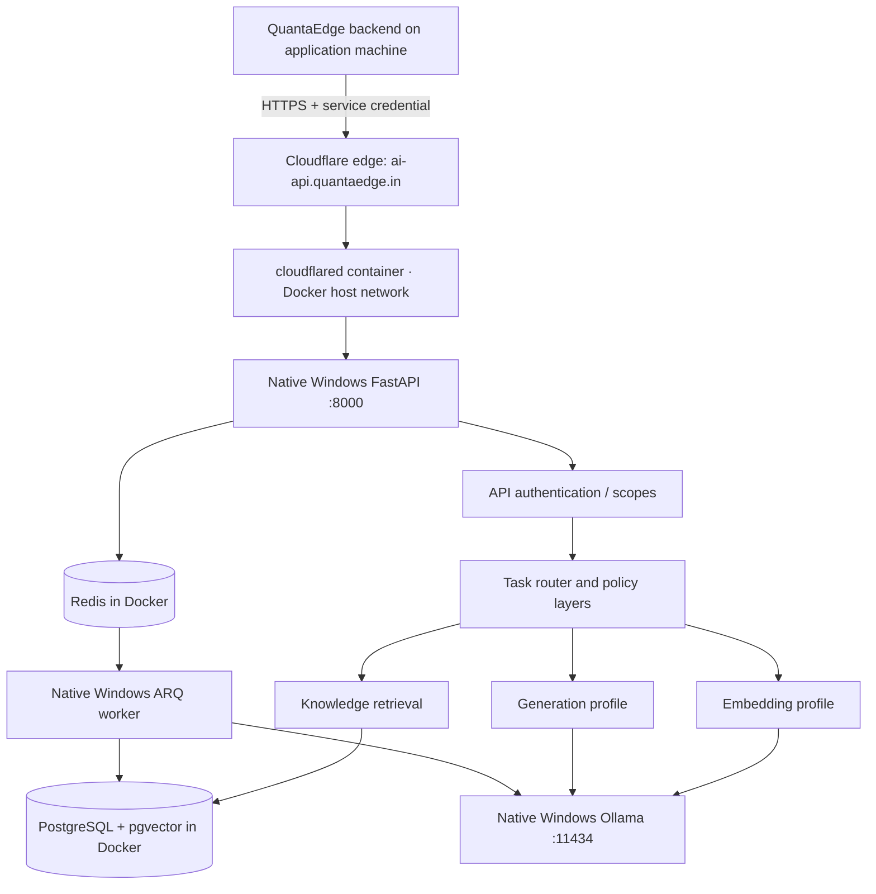

# QuantaEdge AI Platform

Standalone, API-first AI server for QuantaEdge and other authorised applications. This repository runs on the **dedicated AI laptop**. The QuantaEdge website, Android backend, authentication, institution/course enrolment and official learner progress stay on the separate application machine.

## Machine boundary

- **This AI laptop:** native Windows FastAPI gateway, ARQ ingestion worker, native Ollama, PostgreSQL + pgvector, Redis and the cloudflared tunnel connector (in Docker Desktop), knowledge retrieval and model registry.
- **Other machine:** QuantaEdge web/mobile/admin applications and business database. Its backend calls `https://ai-api.quantaedge.in` over HTTPS.
- **Not in Git:** model weights, Docker Desktop WSL virtual disk, database volumes, Redis data, uploaded documents, licensed NCERT files, secrets or backups.

The API listens on `127.0.0.1:8000`. The cloudflared Docker container uses Docker Desktop host networking to forward `ai-api.quantaedge.in` and the separately Access-protected `harness-ai-api.quantaedge.in` to that local address. Ollama listens on `127.0.0.1:11434` and is never exposed to the LAN or internet. DeepSeek Harness is configured as another client through the separate OpenAI-compatible `/compat/v1` surface; it uses the same Model Gateway and Ollama runtime.

## Architecture



Running the API and worker natively on Windows is intentional: they can call Ollama through loopback without binding the unauthenticated Ollama API to a network interface. Docker Desktop runs PostgreSQL, Redis and cloudflared. The cloudflared service is profile-gated and uses host networking (Docker Desktop 4.34+) to reach the API at localhost:8000 without changing the API bind. See ops/cloudflared/README.md.

## Layered configuration

Behaviour is controlled by separate files under `config/`; route code must not contain one-off model settings.

| Layer | Owns |
|---|---|
| `infrastructure.yaml` | service limits, timeouts, worker and storage defaults |
| `providers.yaml` | provider endpoints and capabilities |
| `models.yaml` | logical model profiles, physical model IDs, capabilities and embedding dimensions |
| `tasks.yaml` | task-to-model routing, prompts and inference parameters |
| `retrieval.yaml` | chunking, top-k, filters and score thresholds |
| `curriculum.yaml` | curriculum catalogue and academic hierarchy |
| `security.yaml` | API scopes, upload rights gate and network policy |
| `prompts/` | versioned task prompts, separate from route code |

Machine-specific secrets and paths belong in the ignored `.env` file. Restart the API/worker after changing YAML configuration; configuration is loaded once per process.

## Initial local model profiles

The initial profiles match models installed on this AI laptop:

- `qwen3-embedding-0.6b` → `qwen3-embedding:0.6b` → **1,024 dimensions**.
- `qwen3.5-teacher-2b` → `qwen3.5:2b-q4_K_M` → text generation.

These are development candidates, not certified teaching models. Inference parameters including `think`, temperature, context and output limits are set in `config/tasks.yaml`. The API sends the task policy to the provider adapter; applications do not select raw Ollama tags. Image/vision APIs are not yet implemented, so the 2B profile is advertised as text-chat only.

## Windows storage layout

Expected workspace root: `D:\QuantaEdgeAI`

```text
D:\QuantaEdgeAI\
├── projects\knowledge-engine\       # clone this repository here
├── models\ollama\                   # native Ollama weights (not Git)
├── data\uploads\                    # originals (not Git)
├── data\processed\                  # extracted text / page assets (not Git)
├── data\temporary\                  # temporary work (not Git)
├── docker\desktop-data\             # Docker-managed WSL virtual disk (not Git)
├── logs\                              # runtime logs (not Git)
└── backups\                           # backups (not Git)
```

PostgreSQL and Redis use Docker named volumes inside Docker Desktop's WSL disk image, whose location is configured in Docker Desktop as `D:\QuantaEdgeAI\docker\desktop-data\DockerDesktopWSL`. The pre-created `data\postgres` and `data\redis` folders are reserved and are not used by the current named-volume configuration.

## Prerequisites

- Windows 11, WSL 2 and Docker Desktop using the WSL 2 engine. Ubuntu is not required.
- Python **3.12**. Install with `winget install --id Python.Python.3.12 -e --source winget`, then reopen PowerShell.
- Ollama for Windows with the model profiles above; `OLLAMA_MODELS` should point to `D:\QuantaEdgeAI\models\ollama`.
- Git for Windows and GitHub CLI for source control.
- Keep the laptop awake and online while the public API is expected to respond.

## First-time setup on the AI laptop

Clone this repository into `D:\QuantaEdgeAI\projects\knowledge-engine`, then from PowerShell:

```powershell
cd D:\QuantaEdgeAI\projects\knowledge-engine
.\scripts\initialize.ps1
```

The script creates a Python 3.12 virtual environment, installs dependencies and generates a local `.env` with random database and API credentials if one does not already exist. Keep `.env` private. Store the printed `quantaedge-backend` key in the application backend's secret manager.

Start database infrastructure:

```powershell
.\scripts\start-infrastructure.ps1
```

Run migrations:

```powershell
.\scripts\migrate.ps1
```

Open a separate PowerShell terminal and start the API:

```powershell
.\scripts\start-api.ps1
```

Open another terminal and start the ingestion worker:

```powershell
.\scripts\start-worker.ps1
```

Check local services:

```powershell
.\scripts\check.ps1
```

Local API docs: `http://127.0.0.1:8000/docs`. API liveness: `http://127.0.0.1:8000/health`. Authenticated readiness: `http://127.0.0.1:8000/ready`. Harness integration and setup: [docs/DEEPSEEK_HARNESS.md](docs/DEEPSEEK_HARNESS.md).

## API contract overview

All application endpoints use `/v1`. Requests require `X-API-Key`; issue distinct least-privilege credentials to each server-side consumer. Never embed the key in React or Android.

| Method | Path | Purpose | Scope |
|---|---|---|---|
| GET | `/health` | Liveness only | Public |
| GET | `/ready` | Database, Redis and Ollama readiness | `admin:read` |
| GET | `/v1/models` | Enabled logical profiles | `models:read` |
| POST | `/v1/chat/completions` | General AI chat | `chat` |
| POST | `/v1/embeddings` | Embeddings | `embeddings` |
| POST | `/v1/learning/answers` | Curriculum-filtered grounded answer | `learning` |
| POST | `/v1/knowledge/documents` | Upload and queue authorised material | `knowledge:write` |
| GET | `/v1/knowledge/documents/{id}` | Ingestion status | `knowledge:read` |

The application machine remains authoritative for learner identity, institution membership, enrolment and official progress. The AI service accepts opaque `learner_ref` and optional `institution_ref` values from the authenticated application backend. Shared curriculum documents have no `institution_ref`; institution-specific documents are restricted to their matching institution.

## Cloudflare Tunnel

Create a remotely managed tunnel in Cloudflare and run the cloudflared connector in Docker Desktop using the cloudflare Compose profile. See [`ops/cloudflared/README.md`](ops/cloudflared/README.md). The connector runs on the AI laptop, not on the application machine. Never tunnel Ollama (11434), PostgreSQL (5432), Redis (6379) or the Harness UI.

## Curriculum and rights boundary

The repository contains curriculum metadata and ingestion code, not NCERT books or extracted textbook passages. Ingest a source only after the intended use is covered by documented rights, including storage, extraction, embedding, retrieval, display and generated derivatives. The API's rights attestation is a technical gate, not legal verification.

## Download licensed textbooks from QuantaEdge GHCR

The class-wise textbook source is maintained in the separate `Manav326/QuantaEdge` repository and its GitHub Container Registry packages. This AI Platform repository contains the downloader code only; textbook PDFs, model files, credentials and download reports stay outside Git.

From PowerShell in this repository, run:

```powershell
.\scripts\download-quantaedge-textbooks.ps1
```

By default, the script downloads every book from all fourteen class/language images (Classes 6–12, Hindi and English) into `D:\QuantaEdgeAI\downloads\textbooks`, organized by class and language. Each folder contains its registry `index.json` and a `books` directory of complete PDFs. A `download-report.json` records the registries completed.

You can select one class or language:

```powershell
.\scripts\download-quantaedge-textbooks.ps1 -ClassNo 6
.\scripts\download-quantaedge-textbooks.ps1 -Language hindi
.\scripts\download-quantaedge-textbooks.ps1 -ClassNo 8 -Language english
```

Docker Desktop must be running, and Docker must be authenticated to `ghcr.io` with an account that has `read:packages` access to the QuantaEdge textbook packages. The script selects this repository's `.venv` Python when available, otherwise the active `python` on `PATH`; it installs `PyMuPDF>=1.24,<2` into that environment only when missing. It checks the registry metadata, canonical whole-book paths, SHA-256 hashes and PDF page counts before updating the destination. Existing PDFs with matching hashes are reused.

The downloader reads only complete books already published in the QuantaEdge GHCR registry. It does not fetch arbitrary URLs or fall back to individual chapter PDFs. A failed registry is recorded as a failed run and is not marked complete. Set `QUANTAEDGE_TEXTBOOK_DOWNLOAD_DIR` or pass `-OutputRoot` to choose another destination. Do not commit downloaded books to Git; keep GHCR packages private according to the applicable licence terms.

## Current scope and release status

This is an initial development baseline: API gateway, logical model routing, Ollama provider, 1,024-dimension embedding schema, knowledge ingestion queue, curriculum-filtered vector retrieval, source metadata, scoped API keys and Windows lifecycle scripts. Hybrid search, reranking, vision ingestion, full evaluation suite, rate limiting and production observability remain planned work. The OpenAI-compatible Harness surface includes non-streaming and SSE chat plus tool-call transport; actual tool-use quality still requires evaluation of the installed model. Do not use real learner or confidential data until the security release gates in `SECURITY.md` are implemented and reviewed.

## Development checks

```powershell
.\.venv\Scripts\python.exe -m compileall apps\api\app apps\api\alembic
.\.venv\Scripts\python.exe -m pytest apps\api\tests -q
```

## License

MIT applies to original code in this repository only. It does not grant rights to third-party model weights, textbooks or datasets.
